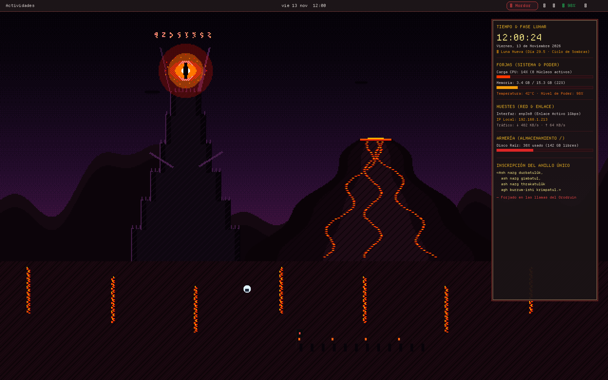
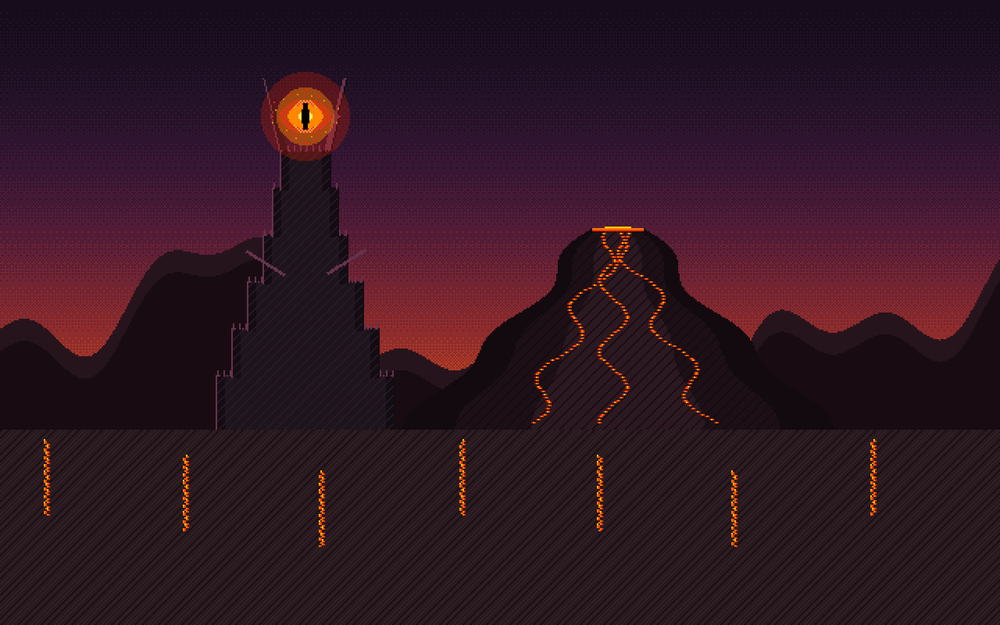
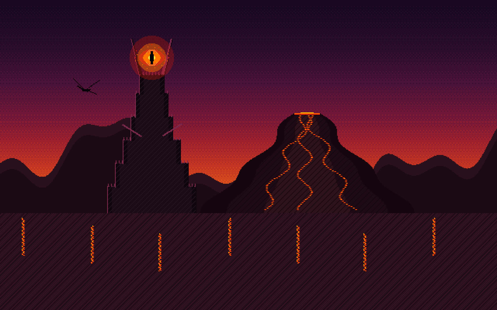
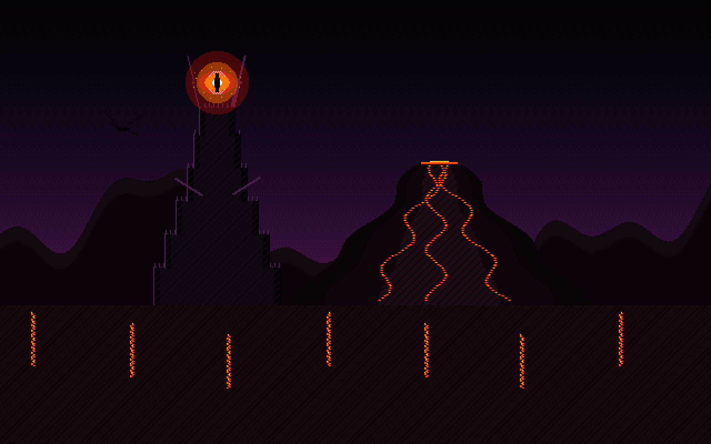
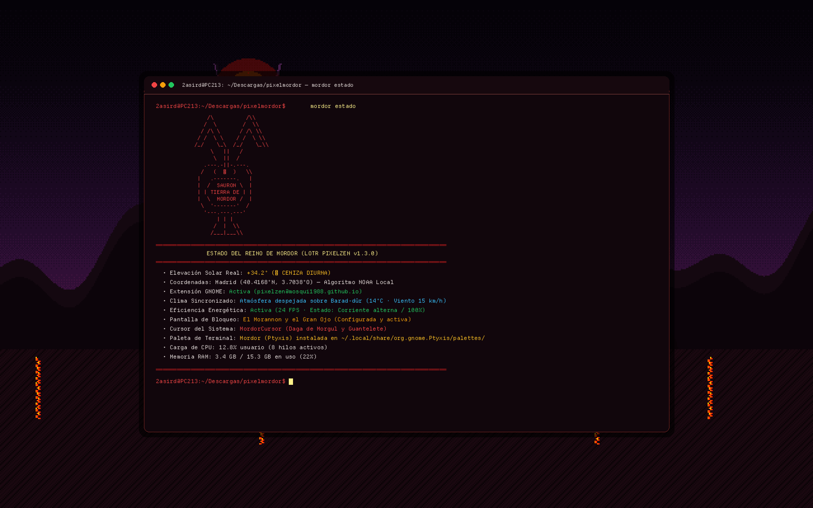
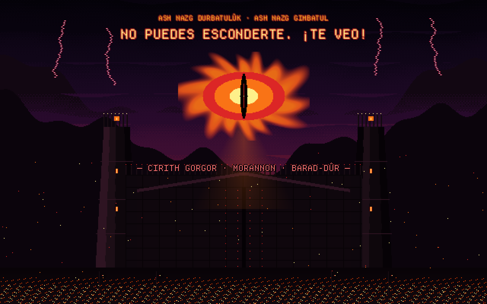

# PixelMordor

[](https://johndsil.github.io/pixelmordor/)
[](https://extensions.gnome.org/)
[](gnome/gtk/mordor-gtk.css)
[](LICENSE)

> Tema de escritorio para **GNOME Shell y Linux** en pixel art: paisaje volcánico animado de **Mordor (El Señor de los Anillos)** que sigue la trayectoria solar real de tu ciudad, panel de datos interactivo (HUD), síntesis de audio sin dependencias, cursores temáticos y herramientas de control.


**Instalación rápida:** clona el repositorio y ejecuta `./instalar.sh`:

```bash
git clone https://github.com/JohnDSil/pixelmordor.git
cd pixelmordor
./instalar.sh
```

Licencia: **GPL-3.0-or-later** (código y arte). Las fuentes tipográficas y glifos mantienen sus licencias originales en `licencias/`.

---

Un tema de escritorio completo para entornos Linux (con soporte especializado para **GNOME Shell**) inspirado en la mitología de **J.R.R. Tolkien y la Tierra Media**:
paisaje animado que sigue el sol real de tu ciudad mediante cálculo astronómico local, seguimiento del ratón por el Ojo de Sauron, sistema de partículas de magma, audio dinámico, menú en el panel superior, cursor temático forjado en hierro y un HUD con métricas del sistema. Todo se genera con **Python puro y GNOME Shell GJS** (sin dependencias pesadas).

---

## 📸 Capturas



**El escritorio.** La llanura de Gorgoroth dibujada píxel a píxel: la torre oscura de **Barad-dûr**, el **Monte del Destino (Orodruin)** en erupción, la marcha de la hueste orca, la patrulla de las Bestias Aladas de los Nazgûl y, en la columna lateral, el panel de datos (HUD) con la forja del sistema.

### El fondo sigue al sol (Algoritmo NOAA)

| Ceniza Diurna (Día) | Hora de Sangre (Crepúsculo) | Noche de Sombras |
|---|---|---|
|  |  |  |

El fondo no es una imagen fija: es una escena animada que evoluciona según la **posición solar real de tu ciudad**:

- El sol recorre el firmamento según la ecuación de tiempo y declinación astronómica oficial de la NOAA. El cálculo se ejecuta en local, por lo que **no requiere conexión a internet**.
- El paisaje transita suavemente entre tres iluminaciones: **Ceniza Diurna**, **Hora de Sangre** (crepúsculo) y **Noche de Sombras**.
- En el crepúsculo y la noche emergen ascuas flotantes, las runas del Anillo Único en Tengwar doradas sobre las nubes, los destellos de las antorchas orcas y los arcos de plasma de Barad-dûr.
- Para probar el ciclo completo sin esperar: `mordor demo` (recorre 24 horas en 90 segundos). Para regresar al reloj astronómico: `mordor auto`.

---

## 🖱️ Interactividad de Escritorio

El fondo de pantalla reacciona a los clics del usuario con efectos visuales y sonoros:

1. **Monte del Destino (Orodruin):** Desata una super-erupción con bombas de magma parabólicas y estruendo sísmico (`erupcion.wav`).
2. **Torre de Barad-dûr:** Desata la cólera del Gran Ojo, expandiendo una onda de choque ígnea sobre el horizonte (`sauron.wav`).
3. **Bestia Alada Nazgûl:** Al hacer clic sobre el Nazgûl en vuelo, emite su chillido característico y se lanza en picado rasante (`nazgul.wav`).
4. **Frodo y Sam (Easter Egg):** Clic en los hobbits que se arrastran por la cresta de Gorgoroth para iluminar el Frasco de Galadriel con sonido armónico (`anillo.wav`).
5. **Llanuras de Gorgoroth:** Abre fisuras de magma incandescentes en el suelo volcánico.

---

## 📊 Panel de Datos del Sistema (HUD)

El panel lateral es un componente interactivo con estética de Mordor que monitoriza el estado del equipo:

- **Reloj y Calendario:** Hora, fecha y fase lunar astronómica. Clic para abrir el Calendario del sistema.
- **Forjas (Rendimiento):** Carga de CPU, memoria RAM en uso, temperatura y nivel de poder. Clic para abrir `htop` en la terminal.
- **Huestes (Red):** Estado de red, tráfico, IP local y externa. Clic para abrir Ajustes de Red.
- **Armería (Disco):** Espacio en disco libre e inventario. Clic para abrir el explorador de archivos.
- **Inscripción del Anillo:** Versos del Anillo Único grabados a fuego con rotación periódica. Clic para cambiar de cita.

---

## 🔊 Paisaje Sonoro Sintetizado

Todos los efectos de sonido se han sintetizado digitalmente en Python puro (PCM 16-bit a 44.1 kHz), garantizando reproducción instantánea sin códecs externos ni descargas:

- `anillo.wav`: Campanada armónica de oro y resonancia mística.
- `erupcion.wav`: Retumbar subterráneo de baja frecuencia y estallido volcánico.
- `sauron.wav`: Gong sobrenatural y resonancia de Barad-dûr.
- `nazgul.wav`: Chillido estridente con modulación FM y deslizamiento Doppler.
- `ambiente.wav`: Bucle continuo de viento volcánico y eco sísmico.

---

## 🗡️ Cursor Temático: MordorCursor

Incluye un tema completo de cursor Xcursor generado píxel a píxel:
- **Puntero normal:** Daga de Morgul forjada en obsidiana con filo de lava ardiente.
- **Puntero de selección/enlace:** Guantelete de hierro negro de Sauron portando el Anillo Único.
- **Animación de espera:** El Anillo Único de oro rotando sobre su propio eje en 12 fotogramas.

---

## 💻 Herramienta de Terminal `mordor`



Incluye la utilidad de línea de comandos `mordor` con autocompletado en Bash:

```bash
# Consultar estado astronómico y recursos del sistema
mordor estado

# Sincronización automática con la posición solar real
mordor auto

# Pruebas de iluminación
mordor dia       # Mediodía de ceniza
mordor sangre    # Hora de sangre (crepúsculo)
mordor noche     # Sombras nocturnas
mordor demo      # Demostración acelerada (24h en 90s)

# Desencadenantes cinematográficos
mordor erupcion  # Erupción de lava en Orodruin
mordor colera    # Cólera del Gran Ojo
mordor nazgul    # Chillido y ataque en picado del Nazgûl
mordor hobbits   # Resplandor del Frasco de Galadriel
mordor ambiente  # Bucle sísmico subterráneo continuo
mordor cita      # Proclamar cita del Anillo Único
mordor cursor    # Aplicar cursor temático de Mordor
mordor hud       # Alternar panel HUD
mordor clima     # Consultar clima real sincronizado (Open-Meteo)
mordor terminal  # Aplicar paleta oficial de Mordor a Ptyxis
mordor notif     # Enviar notificación de prueba de Sauron
mordor bloqueo   # Configurar o probar pantalla de bloqueo (Morannon)
mordor prompt    # Alternar prompt temático de Mordor en Bash
mordor sonido    # Alternar tema de sonido XDG para eventos de sistema
mordor forjar    # Animación interactiva de la Forja del Anillo Único
mordor gtk       # Activar o desactivar tema GTK4/Libadwaita y GTK3 [on|off]
mordor atajos    # Activar o desactivar atajos globales GNOME [on|off]
mordor grub      # Instalar o gestionar tema de arranque GRUB 2 [on|off]
mordor fondo     # Aplicar fondos multi-resolución [1080p|2k|4k|ultrawide]
mordor motd      # Alternar cita de Tolkien al abrir terminal [on|off]
```

---

## ⚡ Novedades Avanzadas

1. **🔋 Modo Eficiencia Energética / Batería Inteligente:**
   - Detección automática del nivel de batería a través de `/sys/class/power_supply`.
   - Si la batería baja de 25% y se está descargando, se reducen los fotogramas de 24 FPS a 12 FPS y las partículas de ceniza a 8 para maximizar la autonomía.
2. **🌩️ Clima Real Sincronizado:**
   - Consulta meteorológica ultraligera en tiempo real con Open-Meteo (0 claves API).
   - Lluvia y tormentas locales intensifican los relámpagos carmesíes sobre Barad-dûr y espesan la bruma de ceniza.
3. **🔔 Notificaciones Temáticas de Mordor:**
   - Alertas nativas de escritorio ante batería crítica (< 15%) y almacenamiento en disco saturado (> 90%), con títulos e iconografía de Sauron y Barad-dûr.
4. **🎨 Paleta Oficial para Terminal Ptyxis y VS Code:**
   - Paleta de colores `Mordor.palette` para el terminal por defecto de GNOME (Ptyxis).
   - Extensión oficial para Visual Studio Code con tema oscuro de obsidiana y rojo lava (`mordor-theme-1.0.0`).
5. **🔒 Pantalla de Bloqueo Dedicada (El Morannon y el Gran Ojo):**
   - Fondo de pantalla exclusivo para la pantalla de bloqueo (`fondos/mordor-bloqueo.png`) que representa la imponente silueta de la **Puerta Negra de Mordor (*Morannon*)**, las torres gemelas de los Dientes de Mordor (*Carchost y Narchost*) y el Gran Ojo de Sauron vigilando la sesión con el lema: *"NO PUEDES ESCONDERTE. ¡TE VEO!"*.
   - Estilizado de GNOME Shell en `stylesheet.css` para el reloj y campo de contraseña con tipografía rúnica y resplandor de fuego.
   - Opción en el menú superior de GNOME y comando CLI: `mordor bloqueo`.

   

6. **🔊 Tema Oficial de Sonidos XDG (FreeDesktop / GNOME):**
   - Mapeo completo en `~/.local/share/sounds/mordor/` para eventos nativos del sistema:
     - Conectar cargador o dispositivo USB: tintineo del Anillo (`anillo.wav`).
     - Vaciar la papelera: rugido de magma volcánico (`erupcion.wav`).
     - Alertas y errores de diálogo: gong siniestro de Barad-dûr (`sauron.wav`).
     - Ventana solicitando atención: chillido del Nazgûl (`nazgul.wav`).
7. **🐚 Prompt Temático de Terminal para Bash:**
   - Prompt interactivo configurable con `mordor prompt on/off` que incluye el Ojo de Sauron `👁`, estado de Git dinámico (`💍` si el repositorio está limpio, `🌋` si hay cambios) y flecha reactiva en oro o rojo sangre según el código de salida.
8. **💍 Animación Terminal: La Forja del Anillo (`mordor forjar`):**
   - Animación interactiva en ASCII 3D y colores ANSI de la forja del Anillo Único en Orodruin con versos en Tengwar y efectos de sonido.
9. **📦 Paquete EGO Oficial para extensions.gnome.org:**
   - Archivo `.zip` compilado y validado en `gnome/pixelzen@mosqui1988.github.io.shell-extension.zip` listo para su publicación directa en la tienda oficial de GNOME Extensions.
10. **🎨 Tema GTK4 / Libadwaita y GTK3 (`mordor gtk [on|off]`):**
    - Estilizado de ventanas obsidian (`#0d0308`), acentos volcánicos carmesí (`#ef4444`, `#dc2626`), barras de scroll con aspecto de magma y botones sugeridos en gradiente ardiente. Compatible con todas las aplicaciones GNOME (Archivos, Ajustes, Ptyxis, etc.).
11. **⌨️ Atajos de Teclado Globales GNOME (`mordor atajos [on|off]`):**
    - Integración nativa con `org.gnome.settings-daemon.plugins.media-keys`:
      - `Super + Alt + E`: Super-erupción en el Monte del Destino (Orodruin).
      - `Super + Alt + S`: Cólera del Gran Ojo (onda expansiva ígnea).
      - `Super + Alt + N`: Chillido y ataque en picado del Nazgûl.
      - `Super + Alt + B`: Bloquear pantalla en El Morannon.
      - `Super + Alt + F`: Forja 3D interactiva del Anillo Único en Ptyxis.
12. **🌐 Sitio Web Interactivo y GitHub Pages (`docs/index.html`):**
    - Landing page con HTML5 Canvas en tiempo real: Orodruin en erupción, Ojo de Sauron con pupila que sigue al ratón, Nazgûl en vuelo, sintetizador de audio puro con Web Audio API (cero dependencias externas) y simulador de terminal interactivo.
    - Publicable de inmediato en GitHub Pages en `https://johndsil.github.io/pixelmordor/`.
13. **🚀 Tema de Arranque GRUB 2 (`mordor grub [on|off]`):**
    - Pantalla de inicio de sistema en Full HD (1920x1080) con El Morannon y Barad-dûr, tipografía rúnica Departure Mono, selector en obsidiana y lava, e iconos temáticos de sistemas operativos.
14. **🖼️ Fondos Multi-Resolución 2K, 4K y Ultrawide 21:9 (`mordor fondo`):**
    - Generación paramétrica y libre de deformaciones para 1080p, 1440p 2K QHD, 2160p 4K UHD y panorámicos 21:9 (3440x1440 y 2560x1080).
15. **📜 Citas de Tolkien al Abrir Terminal MOTD (`mordor motd [on|off]`):**
    - Mensaje de bienvenida diario con 15 citas de El Señor de los Anillos en castellano y Lengua Negra de Mordor mostrado al instante (< 1ms).

---

## 📦 Qué Incluye el Repositorio

| Directorio / Archivo | Función |
|---|---|
| `gnome/` | Extensión interactiva para GNOME Shell (`pixelzen@mosqui1988.github.io`). |
| `gnome/.../escena.js` | Motor gráfico Cairo/Clutter: Sol, Eye tracking, erupciones, runas, orcos, relámpagos. |
| `gnome/.../hud.js` | Panel lateral interactivo con métricas del sistema y eventos al clic. |
| `gnome/.../sounds/` | Efectos de sonido sintetizados sin dependencias externas. |
| `capturas/` | Capturas y animaciones de muestra en las distintas fases del día. |
| `fondos/` | Fondos de pantalla en alta resolución para cada iluminación. |
| `fuentes/` | Tipografías pixel art: *Departure Mono*, *DotGothic16*, *Pixelify Sans*, *VT323*. |
| `src/` | Generadores en Python de capas HD, iconos, wallpapers y cursores. |
| `hud/` | Widgets y componentes compatibles para KDE Plasma. |
| `fondo-animado/` | Plugin de fondo animado para KDE Plasma. |
| `licencias/` | Licencias GPL-3.0 y licencias OFL/MIT de fuentes y recursos. |
| `mordor` | Script CLI para control y consulta de estado del tema. |
| `instalar.sh` | Instalador automatizado para Linux y GNOME Shell. |
| `desinstalar.sh` | Desinstalador limpio para restaurar la configuración anterior. |

---

## 🚀 Requisitos

- Sistema operativo: **Linux** (probado y optimizado en Ubuntu / Debian / Fedora / Arch).
- Entorno de escritorio: **GNOME Shell 45, 46 o superior** (o KDE Plasma 6).
- Utilidades estándar: `python3`, `fc-cache`, `gsettings`.

---

## 📜 Licencia

PixelMordor está licenciado bajo la **GNU General Public License v3.0 (GPL-3.0-or-later)**.
Las tipografías y colecciones de glifos conservan sus licencias correspondientes (SIL OFL y MIT) en el directorio `licencias/`.
